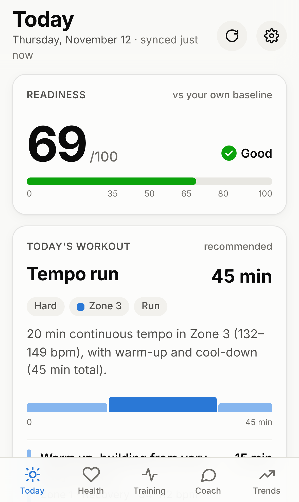
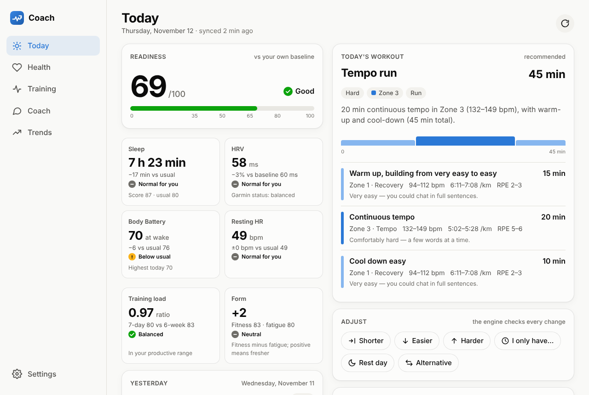

# Coach — personal training coach on Garmin data

A mobile-first, installable PWA that turns your Garmin health and activity
data into one clear answer every morning: **how ready are you, what should
you train today, and why.**

Recommendations come from a **deterministic engine** that compares today's
values with *your own* historical baseline. The AI layer (a later stage) only
explains and adjusts what the engine produced — it never invents a workout.

| Phone | Desktop |
| --- | --- |
|  |  |

## Status

Built in small, tested stages — see [CHANGELOG.md](CHANGELOG.md).

| Stage | What | Status |
| --- | --- | --- |
| 1 | Architecture, monorepo, tooling, CI | ✅ |
| 2 | D1 schema, migrations, repositories | ✅ |
| 3 | Garmin integration service (provider boundary, mock provider, sync) | ✅ |
| 4 | Deterministic readiness + recommendation engine | ✅ |
| 5 | PWA shell + **Today** screen on mock data | ✅ |
| 6 | Private deployment, live Garmin Personal API, personalisation, Garmin workout comparison | in progress |
| 7–11 | Health, Training, Trends, Settings, Coach (AI) | planned |

**Today** shows readiness 0–100, sleep, HRV, Body Battery, resting HR,
training load and form, yesterday's workout, weekly volume, and a structured
workout (warm-up, main set / intervals with recoveries, cool-down, duration,
HR zone + bpm, pace, RPE) with the reasons behind it. You can make it
shorter, easier, harder (guarded), fit it into *X* minutes, swap to a rest day
or an alternative — every change goes through the engine.

## Stack

| Layer | Technology |
| --- | --- |
| Frontend | Preact + Vite, PWA (manifest + service worker), served by the Worker (Workers Static Assets) |
| API | Same Cloudflare Worker (Hono) under `/api/*`; Cloudflare Access + the Worker's own Access-JWT check |
| Database | Cloudflare D1 (SQLite) |
| Data source | Garmin Connect Personal API — server-side only (Stage 6); mock provider until then |
| Engine | `@coach/engine` — pure TypeScript, 75 unit tests |

```
apps/api         Cloudflare Worker: serves the PWA, API, Garmin sync (cron), D1 access
apps/web         PWA source (built into apps/web/dist)
packages/engine  Deterministic readiness + recommendation engine
packages/shared  API contract types
docs/            Design documents
```

## Documentation

* [Architecture](docs/ARCHITECTURE.md) — components, flows, security, roadmap, decisions
* [Database](docs/DATABASE.md) — D1 schema, conventions, migrations
* [Garmin integration](docs/GARMIN_INTEGRATION.md) — Personal API, provider boundary, sync, mock scenarios
* [Engine](docs/ENGINE.md) — baselines, readiness, load, decision rules, workouts, modifications, AI contract
* [API](docs/API.md) — endpoints and payloads
* [Deployment](docs/DEPLOYMENT.md) — resources, security model, deploy, verify, rollback
* [CHANGELOG](CHANGELOG.md)

## Run it locally

Requires Node 22+. Runs entirely on mock data; no Garmin account needed.

```bash
npm install
```

```bash
cp apps/api/.dev.vars.example apps/api/.dev.vars
```

```bash
npm run db:migrate:local -w @coach/api
```

In one terminal, the Worker (builds the PWA, serves it and the API with a local D1 on http://127.0.0.1:8787):

```bash
npm run dev:api
```

Optionally, in another, the PWA with hot reload (http://localhost:5173, proxies `/api` to the Worker):

```bash
npm run dev:web
```

The first load seeds 120 days of synthetic history. Use **Demo data** at the
bottom of Today to switch scenarios (normal, well rested, fatigued, illness,
calibrating), or:

```bash
curl -X POST http://127.0.0.1:8787/api/dev/mock/reset -H 'content-type: application/json' -d '{"scenario":"fatigued"}'
```

### Checks

```bash
npm run check        # typecheck + all tests (engine, API against real local D1, web)
```

```bash
npm run build        # production build of the PWA
```

## Deploy to Cloudflare

One Worker (`garmin-personal-coach`) with its own D1 database
(`garmin-coach-db`) and its own Cloudflare Access application. See
[docs/DEPLOYMENT.md](docs/DEPLOYMENT.md) for the resources, first-time setup,
verification checklist and rollback. Routine deploys:

```bash
npm run check && npm run deploy
```

On the iPhone: open the app URL in Safari → sign in with the emailed code →
Share → **Add to Home Screen**.

## Security

* The Garmin Personal API key is a Worker secret; only the API Worker talks
  to Garmin. No endpoint returns the key or token.
* Cloudflare Access protects the whole hostname (owner email only), and the
  Worker verifies the Access JWT itself on every `/api/*` request (fails closed).
* Health data is never cached on the device: API responses are `no-store` and
  the service worker never stores `/api/*`.
* Strict CSP and security headers; state-changing requests must be JSON (CSRF guard).
* Error messages are sanitized: no keys, tokens or emails in responses or logs.

See [docs/ARCHITECTURE.md § Security model](docs/ARCHITECTURE.md#6-security-model).

## Not medical advice

The engine uses conservative, widely used training heuristics against your own
baselines. If you feel unwell, rest — whatever the score says.
