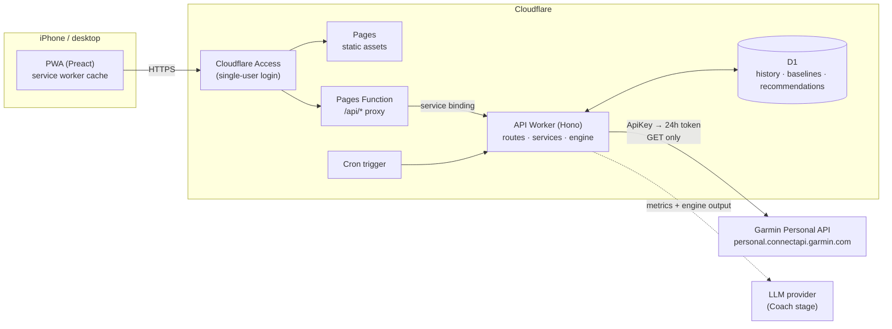

# Architecture

A personal, single-user training coach. Garmin data goes in; a **deterministic
engine** decides what you should train today; an **AI layer** (later stage)
explains that decision and answers questions about it, but never makes it.

## 1. Goals and hard constraints

| Constraint | How the architecture honours it |
| --- | --- |
| Installable PWA, iPhone first, desktop too | Static Preact app on Cloudflare Pages with a web manifest, service worker and iOS meta tags. Mobile layout first, widened with CSS breakpoints. |
| Garmin key never in frontend code | The key is a Worker secret. Only the API Worker talks to Garmin. The browser receives normalised, already-stored data. |
| Deterministic recommendations | `packages/engine` is pure TypeScript: same inputs → same output, with a version stamp. The LLM receives the engine's output and may only pick from the engine's own modification operations. |
| Compare against *your* baseline | Every metric is stored historically in D1. The engine computes rolling personal baselines (mean, SD, z-score) instead of population norms. |
| Single user | No multi-tenancy in the schema. The whole site sits behind Cloudflare Access. |
| Small, testable stages | Each stage lands as its own commit with tests and a CHANGELOG entry. See [Roadmap](#8-roadmap). |

## 2. System overview



### Why Pages **and** a separate Worker

* **Pages** serves the static PWA and gives us preview deployments per branch.
* **Cron triggers only exist on Workers**, and Garmin sync must run on a
  schedule, so the API lives in a standalone Worker (`coach-api`).
* The API Worker has **no public URL** (`workers_dev: false`, no routes). The
  Pages Function `functions/api/[[path]].ts` forwards `/api/*` over a
  **service binding**. Result: one origin for the browser (no CORS, Access
  cookie covers everything), and the API cannot be reached around Access.

## 3. Repository layout

```
.
├── apps/
│   ├── api/                 Cloudflare Worker (Hono)
│   │   ├── migrations/      D1 SQL migrations (wrangler d1 migrations)
│   │   ├── src/
│   │   │   ├── app.ts       route table
│   │   │   ├── index.ts     fetch + scheduled entry points
│   │   │   ├── db/          repositories: the only code that writes SQL
│   │   │   ├── garmin/      provider interface, mock provider, live client (Stage 6), sync
│   │   │   └── services/    use-cases: load history → run engine → persist
│   │   └── test/            vitest + real local D1 via wrangler getPlatformProxy
│   └── web/                 Cloudflare Pages project
│       ├── functions/api/   Pages Function → service binding proxy
│       ├── public/          manifest, service worker, icons
│       └── src/             Preact app (Today, Health, Training, Coach, Trends, Settings)
├── packages/
│   ├── engine/              deterministic readiness + recommendation engine (no I/O)
│   └── shared/              API contract types used by api and web
└── docs/                    architecture, database, Garmin, engine
```

Dependency direction is one-way: `web → shared → engine` and
`api → shared, engine`. The engine depends on nothing.

## 4. Inside the API Worker

```
HTTP request ─▶ routes (validate input, shape JSON)
                  │
                  ▼
               services (use-cases: TodayService, SyncService, …)
                  │            │                 │
                  ▼            ▼                 ▼
           repositories    engine (pure)    GarminProvider
               (D1)                          ├─ MockGarminProvider  (now)
                                             └─ LiveGarminProvider  (Stage 6)
```

* **Routes** never touch SQL or Garmin directly.
* **Repositories** are the only place SQL lives; they map rows ⇄ domain types.
* **Services** compose: load history from repositories, call the engine,
  persist the assessment and recommendation, return a DTO from `@coach/shared`.
* **GarminProvider** returns *normalised* domain records. Swapping mock for
  live changes no other code.

Endpoint reference: [API.md](API.md).

## 5. Key flows

### 5.1 Sync (cron + "Sync now")

1. Cron fires (hourly) or the user taps *Sync now*.
2. `SyncService` reads `sync_state` per domain (activities, sleep, HRV, body
   battery, stress, daily summary) and asks the provider for everything since
   the last synced date, re-fetching the last 3 days because Garmin revises
   recent data as the watch syncs.
3. Records are **upserted** by natural key (calendar date or Garmin activity
   id), so re-running a sync is always safe.
4. A `sync_runs` row records what happened, for the Settings screen.

Live mode only (Stage 6): the Worker exchanges the Personal API key for a
24-hour access token, caches it server-side, and requests a new one shortly
before expiry or on a 401. There are no refresh tokens.

### 5.2 Today

1. `GET /api/today` → `TodayService`.
2. Load ~60 days of daily metrics and ~42 days of activities from D1.
3. Engine: personal baselines → readiness components → training load →
   decision rules → structured workout + reason codes.
4. Persist the assessment and recommendation (`daily_assessments`,
   `recommendations`), so history shows *what was recommended and why*.
5. Return one `TodayResponse` DTO that the screen renders without further
   calculation.

### 5.3 Modify ("make it shorter", "I only have 30 min", …)

`POST /api/today/modify { kind, minutes? }` runs a deterministic engine
transform on the current recommendation. Guardrails live in the engine: e.g.
*harder* is refused when readiness is low, and the response says why. The new
recommendation is stored with `parent_id` pointing at the original.

### 5.4 Coach (later stage)

The LLM receives a JSON bundle: today's metrics, baselines, readiness
components, load, the engine's recommendation and its reason codes. It may:

1. explain the reasoning in natural language,
2. propose modifications — **only** as one of the engine's modification
   operations, which the Worker then executes through the engine,
3. answer questions about the recommendation.

It may not emit a free-form workout. Anything it suggests goes back through
the engine and its guardrails.

## 6. Security model

| Asset | Protection |
| --- | --- |
| Garmin Personal API key | Worker secret (`wrangler secret put GARMIN_PERSONAL_API_KEY`). Never logged, never returned by any endpoint. Settings shows only connection status and key expiry. |
| Garmin access token (24 h) | Stored only in D1, AES-GCM encrypted with a separate Worker secret (Stage 6). |
| Health data in D1 | Only the API Worker has the D1 binding. The Worker has no public route. |
| The app itself | Cloudflare Access policy on the Pages domain (one allowed email / passkey). |
| LLM calls (later) | Server-side only; key is a Worker secret; only derived metrics are sent, never the Garmin key or token. |

## 7. Conventions

* **Dates.** A "date" is the user's local calendar date (`YYYY-MM-DD`) in the
  timezone stored in settings. Sleep belongs to the date you *woke up*
  (Garmin's convention). Timestamps are ISO-8601 UTC strings.
* **Units.** Stored in SI: seconds, metres, metres/second, bpm, milliseconds.
  The UI converts for display (pace = sec/km).
* **Engine version.** Every stored assessment and recommendation carries
  `engine_version`, so a change in rules never silently rewrites history.
* **Missing data** is `null`, never `0`. The engine lowers its confidence and
  says which inputs were missing instead of guessing.

## 8. Roadmap

| Stage | Scope | Status |
| --- | --- | --- |
| 1 | Architecture, monorepo, tooling, CI | done |
| 2 | D1 schema, migrations, repository layer | done |
| 3 | Garmin integration service: provider interface, mock provider, sync into D1 | done |
| 4 | Deterministic readiness + recommendation engine | done |
| 5 | PWA shell + **Today** screen on mock data | done |
| 6 | Live Garmin Personal API (token manager, client, response mappers) | |
| 7 | Health screen (sleep, HRV, Body Battery, RHR, stress, trends) | |
| 8 | Training screen (volume, intensity distribution, activity list/detail, FIT) | |
| 9 | Trends screen (long-term recovery, fitness and load) | |
| 10 | Settings screen (goals, days, duration, zones, Garmin connection) | |
| 11 | Coach: LLM explanations, guarded modifications, Q&A | |

## 9. Decision log

| Decision | Alternatives considered | Why |
| --- | --- | --- |
| Pages + standalone Worker over service binding | Pages Functions only; single Worker with static assets | Cron needs a Worker; binding keeps one origin and hides the API. A single Worker with assets would also work and is a reasonable later simplification. |
| Hono for routing | Hand-rolled router, itty-router | Small, typed, runs on Workers and in Node tests unchanged. |
| Preact + hand-written service worker | React, vite-plugin-pwa | ~10 kB runtime suits a phone; the SW is ~60 lines we fully control (iOS PWA quirks). |
| One D1 table per Garmin domain + view | One wide `daily_metrics` table | Each Garmin endpoint syncs independently and keeps its raw payload; the `v_daily_metrics` view gives the engine one row per day. |
| Intraday series as one JSON row per day per metric | One row per sample | D1 bills and limits by rows; charts always read a whole day at once. |
| Engine in its own package | Inside the Worker | Forces purity, makes it trivially unit-testable, and lets the UI reuse types. |
| Tests against real local D1 (wrangler `getPlatformProxy`) | SQLite mocks | Catches real D1/SQLite behaviour (constraints, upserts, JSON functions). |
