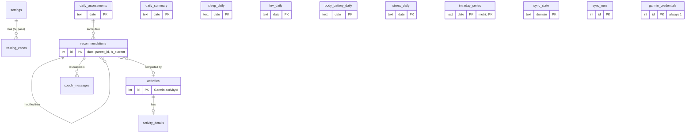

# Database (Cloudflare D1)

Schema: [`apps/api/migrations/`](../apps/api/migrations/) —
`0001_initial.sql` (everything below) and `0002_app_state.sql` (`app_state`).
All SQL lives in `apps/api/src/db/` (repositories). Nothing else writes SQL.

## Design principles

1. **Store history, not just today.** The engine compares today against your
   own rolling baseline, so every daily metric is kept indefinitely.
2. **Source data and derived data are separate.** Garmin data goes into
   source tables (with the raw payload). Engine output goes into
   `daily_assessments` and `recommendations`, stamped with `engine_version`
   and an `inputs_hash`. Changing the engine never rewrites what you were told.
3. **Idempotent writes.** Every source table is keyed by a natural key
   (local date, or Garmin activity id) and written with
   `INSERT … ON CONFLICT DO UPDATE`. Re-syncing a day is always safe.
4. **NULL means unknown.** Zero is a real reading. The engine relies on this
   to lower its confidence instead of treating missing data as "bad".
5. **Single user.** No `user_id`; `settings` and `garmin_credentials` are
   singleton rows (`CHECK (id = 1)`).
6. **D1-friendly.** D1 bills and limits by rows read/written, so intraday
   curves are one JSON row per day per metric rather than one row per sample.

## Conventions

| Thing | Format |
| --- | --- |
| `date`, `local_date` | Local calendar date `YYYY-MM-DD` (timezone from `settings.timezone`), enforced with a `GLOB` check |
| Sleep date | The date you **woke up** (Garmin convention) |
| `*_at` timestamps | ISO-8601 UTC text, e.g. `2026-11-12T06:30:00Z` |
| Units | seconds, metres, m/s, bpm, ms (HRV), kcal |
| Booleans | `INTEGER` 0/1 with a `CHECK` |
| JSON columns | `TEXT` with `CHECK (json_valid(…))` |
| Provenance | `source` (`garmin` / `mock` / `manual`), `fetched_at`, `updated_at`, `raw_json` |

## Entity overview



## Tables

### Configuration

| Table | Purpose |
| --- | --- |
| `settings` | Singleton. Timezone, units, primary sport, goal (+ event date), available weekdays (JSON array, 1 = Mon … 7 = Sun), long-session day, preferred/max duration, quality sessions per week, max HR, resting-HR override, LTHR, threshold pace, birth year, sex. |
| `training_zones` | HR zones (bpm) and pace zones (sec/km, `min_value` is the fast end), 5 per kind. Empty ⇒ the engine derives zones from max HR / LTHR / threshold pace. |

### Garmin source data

One table per Garmin domain, because each comes from a separate endpoint,
syncs independently and may arrive at a different time of day.

| Table | Key | Main columns |
| --- | --- | --- |
| `daily_summary` | `date` | steps, step goal, distance, **resting HR**, min/max HR, kcal, intensity minutes |
| `sleep_daily` | `date` (wake-up) | start/end, duration, deep/light/REM/awake, **sleep score** + qualifier, respiration, SpO₂, sleep stress |
| `hrv_daily` | `date` | **last-night average**, 5-min high, weekly average, Garmin's balanced range, Garmin status |
| `body_battery_daily` | `date` | charged, drained, highest, lowest, **at wake**, end of day |
| `stress_daily` | `date` | average, max, time in rest/low/medium/high stress |
| `intraday_series` | `date, metric` | fixed-interval sample array (JSON) for heart rate, stress, Body Battery, respiration, SpO₂ |
| `activities` | Garmin `id` | sport (normalised) + Garmin type key, start (UTC + local), duration, distance, elevation, HR, speed, power, cadence, kcal, training effect, Garmin load, **time in HR zones 1–5**, user RPE |
| `activity_details` | `activity_id` → `activities` (cascade) | laps, downsampled streams (HR, speed, altitude, power, cadence), optional reference to the original FIT file in object storage |

`activities.rpe` and `activities.has_details` are owned by the app; a
provider re-sync never overwrites them (they are not in the upsert column list).

### Engine output

| Table | Purpose |
| --- | --- |
| `daily_assessments` | One per date (written by `AssessmentRepository`): readiness score/band/confidence, per-component breakdown, the baselines used, the full load model, flags. Load numbers (`daily_load`, `atl`, `ctl`, `tsb`, `acwr`) are also plain columns so Trends can chart them with SQL. `inputs_hash` lets the service skip recomputation when nothing changed. |
| `recommendations` | Every recommendation ever made. `origin = 'engine'` rows are the engine's own choice; `origin = 'modification'` rows point to their `parent_id` and record the `modification_kind` (+ minutes for *I only have X minutes*). A partial unique index guarantees **at most one `is_current` per date**. `status` / `completed_activity_id` link it to what you actually did. |

### Garmin connection and sync

| Table | Purpose |
| --- | --- |
| `garmin_credentials` | Singleton. Cached 24-hour access token (AES-GCM ciphertext + IV) and its expiry; the Personal API key's expiry date for a reminder. **The key itself is never stored in D1** — it is a Worker secret. |
| `sync_state` | Per domain: newest/oldest synced date, last success, last error. Drives incremental sync and the Settings status panel. |
| `sync_runs` | Audit log of each sync (trigger, provider, range, per-domain counts, error). |

### App state

| Table | Purpose |
| --- | --- |
| `app_state` | Small key/value store for app-level state that is not a user setting. Today: `mock_scenario`, so every sync in mock mode regenerates data for the same scenario the database was seeded with. |

### Coach

| Table | Purpose |
| --- | --- |
| `coach_messages` | Conversation per date, linked to the recommendation being discussed. `action_json` holds a modification the assistant proposed **as an engine operation**, never a free-form workout. |

### View: `v_daily_metrics`

Joins the five daily source tables into one row per date — exactly the
`DailyMetrics` shape the engine consumes. Dates present in *any* table appear;
missing domains are `NULL`.

## Volume and limits

Roughly 10–12 rows per day (5 daily tables, 3–5 intraday rows, ~1 activity)
≈ 4,500 rows per year. An hourly sync that re-fetches the last 3 days writes
about 700 rows per day, far below D1's free-tier limits. FIT files are not
stored in D1 (2 MB row limit); parsed laps and downsampled streams are.

## Migrations

```bash
npx wrangler d1 create coach-db          # once; put the id in apps/api/wrangler.jsonc
```

```bash
npm run db:migrate:local -w @coach/api   # local dev database
```

```bash
npm run db:migrate:remote -w @coach/api  # production
```

Rules: never edit an applied migration; add `0002_*.sql` etc. Tests apply
every file in `migrations/` in order to a fresh in-memory D1.

## Testing

`apps/api/test/helpers/db.ts` starts a real local D1 (workerd + SQLite)
through wrangler's `getPlatformProxy`, applies all migrations, and resets
tables between tests. `schema.test.ts` checks constraints;
`repositories.test.ts` checks round-trips, idempotent upserts, app-owned
columns surviving re-syncs, cascade deletes, sync bookkeeping and multi-row
upserts staying under D1's 100-bound-parameter limit.

Writes of many rows use multi-row `INSERT … VALUES (…), (…) ON CONFLICT …`
statements packed under that limit, then sent in `db.batch()` groups (each
batch is atomic).
